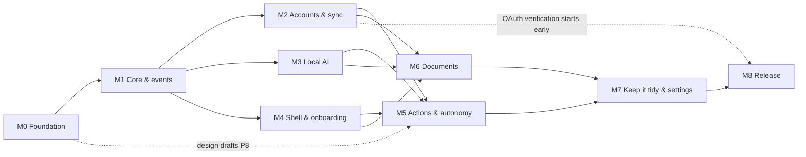

# Pochimail — plan

Living document. `docs/brief.md` is the source of truth; this file shows **order, dependencies and decisions**. When a decision changes, update this file, the affected issues and `AGENTS.md` in the same PR.

Status: **plan decisions P1 to P15 and ADRs 0001 to 0008 accepted by the maintainer on 2026-11-17** (M0-15).

---

## 1. Decisions

### Made
| # | Decision | Date | Where it lives |
|---|---|---|---|
| D1 | Repo `pochimail/pochimail`, owner read from one config value | brief | brief › top |
| D2 | Code license **AGPL-3.0**; brand assets separate (TRADEMARKS.md, CC BY-NC-ND 4.0) | 2026-11-17 | brief §8, §9b |
| D3 | Repo is **public** from day one | 2026-11-17 | brief §10 |
| D4 | **Any provider in v1**: Gmail API, Microsoft Graph, and a generic IMAP connector with presets (Yahoo, iCloud, Fastmail, GMX…). OAuth/XOAUTH2 where allowed, app password in the keychain otherwise | 2026-11-17 | brief §1, §4, §5.1, §5.3, §7 |
| D5 | **7 fixed categories, empty ones hidden** in sidebar/Overview for the current account selection | 2026-11-17 | brief §3 |
| D7 | **`apps/cli` dev-only pipeline CLI (ADR 0001)**: private, never shipped; it is the brief §10 M1 "CLI running the full pipeline on fixtures" | 2026-11-17 | brief §5.1, §10, ADR 0001 |
| D8 | **Unsubscribe is the one irreversible action**: its ActionLog entry has `inverse: null`, `irreversible: true` and a reason; every other applied action must record its inverse (M1-02, accepted deviation from "undo everything") | 2026-11-17 | brief §2, §5.3, M1-02 |
| D9 | **Autopilot confidence threshold defaults to 0.9** (`AUTOPILOT_CONFIDENCE_THRESHOLD`), tuned later against the eval set; Autopilot may auto-apply only archive and unsubscribe (M1-05, default pending calibration) | 2026-11-17 | brief §2, M1-05 |
| D10 | Autopilot may unsubscribe (brief §2) although unsubscribe is irreversible (D8); it is logged and reported after, decided by the maintainer 2026-11-17 | 2026-11-17 | brief §2, M1-05 |
| D11 | **Store metadata, not mail**: persist headers, metadata and derived data only; full bodies and attachments are never persisted (a saved document is the one exception); FTS5 indexes metadata + derived data only. JD approved ([ADR 0009](adr/0009-store-metadata-not-mail.md)) | 2026-11-18 | brief §5.3, §5.10, ADR 0009 |
| D6 | **Tracker = GitHub Project "Pochimail v1"** with draft items; a draft becomes an issue only when work starts | 2026-11-17 | brief §10 |

### Decided by the maintainer (2026-11-17, M0-15)

JD (maintainer) accepted every proposed default on 2026-11-17 (decision sheet items 1 to 33). Addition to P10 below.

| # | Question | Decision | Date | Decided by | Blocks |
|---|---|---|---|---|---|
| P1 | RFC 8058 one-click unsubscribe is an HTTPS POST to the sender's host, outside the network allowlist | **Allow it through one dedicated, logged path**: POST only to the exact `List-Unsubscribe` URL, no cookies, no redirects followed, no body links ever. Listed in the threat model | 2026-11-17 | maintainer | M5 unsubscribe |
| P2 | `mailto:` unsubscribe needs a send scope (`gmail.send`, `Mail.Send`, SMTP) | **Opt-in**: ask for the send permission the first time; otherwise open the user's mail app with the draft prefilled | 2026-11-17 | maintainer | M2 scopes, M5 |
| P3 | Model hosting | **Hugging Face repos, including community GGUF/ONNX conversions, pinned by SHA-256**, listed in a signed manifest on GitHub Releases. Fallback mirror: our GitHub Releases (2 GiB/asset limit). Download hosts, exact names only: `huggingface.co` and `us.aws.cdn.hf.co` ([ADR 0006](adr/0006-local-ai-runtimes-and-models.md)) | 2026-11-17 | maintainer | M3 downloader |
| P4 | Keep it tidy labels differ (brief / summary / settings) | **"As it arrives · Once a day · Once a week · Only when I ask"** everywhere; Settings segmented control uses the short forms "As it arrives · Daily · Weekly · Off" (same values) | 2026-11-17 | maintainer | M4, M7 copy |
| P5 | Mascot breathing timings differ (mascot.md / design.md / Motion.dc.html) | **`Motion.dc.html` is the source of truth for every timing**; fix design.md/mascot.md to match in M0 | 2026-11-17 | maintainer | M4 motion |
| P6 | Order: you commit after setup vs. PR-only protection | **Local initial setup (M0-01, M0-02, M0-03) → you commit + push → protection on → issues created** (already done before M0-15) | 2026-11-17 | maintainer | M0 |
| P7 | Design export glitches (dark/phone Overview empty % and blank Pause; phone Setup missing checkboxes; phone Settings crushed segmented labels; dark Setup outline on unselected modes) | **Light desktop screens are canonical**; the others are references for theme/layout only, and the bugs are not reproduced | 2026-11-17 | maintainer | M4 |
| P8 | Who designs the undesigned screens (review lists, Documents, Activity & undo, menu-bar popover, Autopilot summary, "Other provider" connect form) | **Agents draft HTML mocks in `docs/design/screens/html/` from the design system; you approve each** before the build issue starts | 2026-11-17 | maintainer | M4–M7 |
| P9 | Do final 3D renders + Rive block v1.0? | **No**: v1.0 can ship with placeholder PNGs + CSS motion; Rive lands when renders exist | 2026-11-17 | maintainer | M8 |
| P10 | Apple Developer ID, Windows signing (e.g. Azure Trusted Signing), external security review budget | **Needed before M8; confirm availability, no spend now.** Addition: **no Mac App Store and no Microsoft Store for now**; desktop builds ship as direct downloads from GitHub Releases, linked later from the getpochimail.com landing page (E8, P14). Signing certificates are still decided before M8 | 2026-11-17 | maintainer | M8 |
| P11 | Opt-in crash reporting needs an outbound host | **Defer to v1.x** (no crash reporting in v1; local logs + "export diagnostics" button) | 2026-11-17 | maintainer | — |
| P12 | Training data for the decision heads (user mail can't be used) | **Synthetic multilingual corpus generated offline + the fixture mailbox + public corpora with compatible licenses**, kept in `packages/ai/training/`; no maintainer mail in the repo | 2026-11-17 | maintainer | M3 |
| P13 | UI language in v1 | **English UI in v1, i18n-ready** (all strings in a catalog, FR/JA layouts tested for expansion); FR/JA translations in v1.x | 2026-11-17 | maintainer | M4 |
| P14 | Website getpochimail.com hosting | **Static site on GitHub Pages** from the repo (`apps/web` later) | 2026-11-17 | maintainer | M8 |
| P15 | Package manager | **pnpm** (not Bun): electron-builder + native module rebuilds are best supported there (ADR 0001) | 2026-11-17 | maintainer | M0 |

### Working assumptions (not questions)
- Sub-agents are Orca workers (Sonnet) running inside the repo; reviewers are separate workers; Haiku for read-only lookups.
- Versions are verified at scaffold time and pinned in the lockfile; nothing relies on memory.

---

## 2. Milestones

| Milestone | Goal (done when) | Epic |
|---|---|---|
| **M0 Foundation** | Monorepo builds on macOS/Windows/Linux CI; design material lives in code; Electron skeleton opens a hardened window with tokens + fonts; ADRs accepted; AGENTS.md in place | E0 |
| **M1 Core & events** | `pnpm pochi:run fixtures/mock` runs sync → classify → signals → suggestions → apply → undo entirely in memory and prints the mock-dataset summary; eval harness reports precision/recall | E1 |
| **M2 Accounts & sync** | Real Gmail, Microsoft and IMAP (Yahoo/iCloud presets) accounts connect, sync incrementally into encrypted SQLite, resume after restart, poll adaptively, survive rate limits/offline | E2 |
| **M3 Local AI** | Models download per hardware tier; rules + decision heads + LLM classify the fixture with target precision; signals, topics, explanations; on-device learning; accuracy + latency gates in CI | E3 |
| **M4 Desktop shell & onboarding** | Welcome → Connect → Setup → Overview while sorting → Summary sheet, live from worker events, responsive, light/dark, all 7 states + motion catalog in the gallery | E4 |
| **M5 Actions & autonomy** | Review screens, batch archive/label/unsubscribe with preview, undo across restarts, Activity & undo, Just look / Suggest / Autopilot policies | E5 |
| **M6 Documents** | Real documents detected, deduped, browsable, exported with clean names | E6 |
| **M7 Keep it tidy & settings** | Scheduler cadences, menu bar/tray + popover, login item, notifications (privacy default, quiet hours), digests, full Settings | E7 |
| **M8 Release** | Signed/notarized builds for 3 OSes, auto-update stable/beta, model manifest updates, OAuth verifications, a11y pass, security review, v1.0 | E8 |

---

## 3. Dependency graph

Notes:
- M2, M3 and M4 run **in parallel** after M1: they meet only through `core` ports and the IPC contract (M4-01), and each has in-memory/fixture stand-ins from M1.
- M4 can start its UI components (`packages/ui`) during M1, since they only depend on M0.
- Long-lead items start early, inside earlier milestones: Google/Microsoft/Yahoo OAuth verification (filed in M2, finished in M8), code-signing certificates (P10), design drafts for review screens (P8, during M2–M4).

---

## 4. Order of execution (lanes)

Max parallelism; one issue = one worker = one PR. Issue numbers are draft IDs (`M0-01`…) until created on GitHub.

**Wave 0 — local, before the first commit (P6)**
`M0-01` monorepo scaffold → `M0-02` move design material → `M0-03` repo docs (AGENTS.md, README, LICENSE…). You commit and push; I enable protection and create issues.

**Wave 1 — M0 in parallel**
- Lane A (tooling): `M0-04` strict TS/Biome/knip/manypkg → `M0-05` CI matrix → `M0-06` Renovate + supply chain
- Lane B (UI): `M0-07` shadcn components → `M0-08` Storybook + contrast gate
- Note (M0-04/M0-05 context): root scripts `lint`, `knip`, `eval`, `build` exist but no workspace defines them yet, so `turbo run` reports "0 total" and exits 0. Once they are wired, CI must fail when a gate task's count is 0 (a gate that runs nothing must not pass).
- Note (M0-07 scope): includes the `Mascot` component (`pose` prop over the PNGs in `packages/ui/src/assets/mascot`), per brief §6.
- Lane C (desktop): `M0-09` Electron skeleton + hardening → `M0-10` packaging smoke build
- Lane D (research, docs only): `M0-11` local AI runtimes/models · `M0-12` encrypted SQLite on Electron × 3 OS · `M0-13` OAuth/provider policies (Google CASA, MS publisher, Yahoo, IMAP XOAUTH2) · `M0-14` IPC transport
- `M0-15` ADRs accepted (after research updates) · `M0-16` threat model v0 · `M0-17` doc consistency fixes (P4, P5)

**Wave 2 — M1**
- Lane A (domain): `M1-01` primitives → `M1-02` entities → `M1-03` ports → `M1-04` events + bus → `M1-05` policies → `M1-06` actions/undo
- Lane B (runtime): `M1-07` outbox + job queue (in-memory, contract tests) → `M1-08` staged pipeline
- Lane C (data): `M1-09` in-memory adapters + contract suites · `M1-10` fixture mailbox + generator → `M1-11` eval harness
- Then: `M1-12` use cases (sync/classify) · `M1-13` use cases (signals/suggestions/digest) → `M1-14` CLI end to end
- Parallel UI lane (only needs M0): `M4-03` ui components can start here.

**Wave 3 — M2 ∥ M3 ∥ M4** (each its own epic, lanes inside)

**Wave 4 — M5 ∥ M6**, then **M7**, then **M8**.

---

## 5. How work is tracked
- GitHub Project "Pochimail v1": one draft item per ticket; fields Status, Plan milestone (M0–M8; "Milestone" is reserved by GitHub), Priority, Size, Area, Draft ID; views Board (by Status) and Plan (table grouped by Plan milestone). Repo milestones M0–M8 exist for when drafts become issues.
- Labels: `type:feature|bug|chore|docs`, `area:core|mail|ai|ui|desktop|infra|design`, `p0|p1`, `blocked`.
- A draft is converted to a repo issue when a worker picks it up (so its PR closes it); no other repo issues before v1.
- ADRs: `docs/adr/` (drafts 0001–0008, all *Accepted* 2026-11-17 in M0-15).
